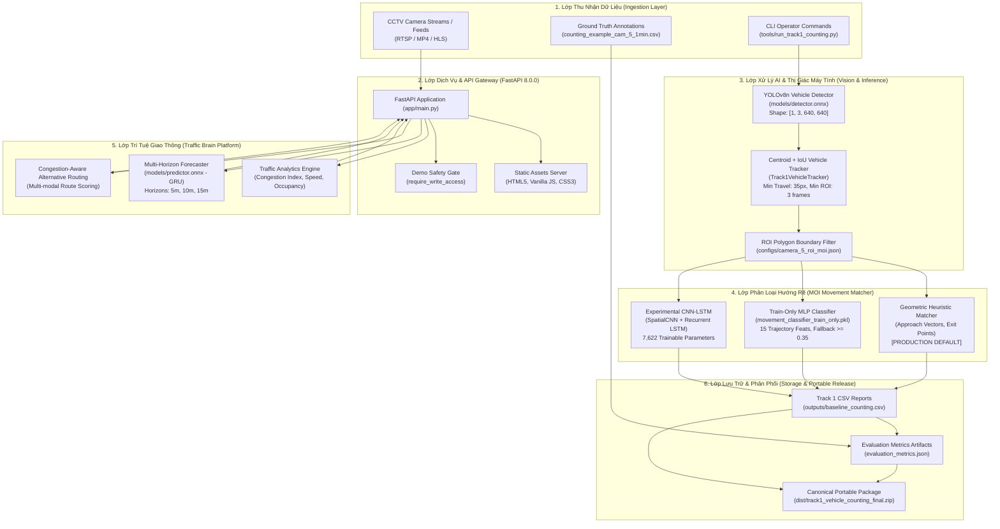

# HANOI TRAFFIC PLATFORM v8.0.0
# BÁO CÁO TOÀN DIỆN KIẾN TRÚC HỆ THỐNG, TRIỂN KHAI VÀ NGHIỆM THU KỸ THUẬT
### (SYSTEM ARCHITECTURE, DEPLOYMENT AND COMPREHENSIVE ENGINEERING AUDIT REPORT)

**Mã phiên bản**: Hanoi Traffic Platform `v8.0.0-final`  
**Ngày phát hành**: 23/10/2026  
**Workspace**: `D:\hanoi-traffic-platform-final-8.0`  
**Mục đích tài liệu**: Tài liệu bàn giao dự án hoàn chỉnh, phục vụ triển khai sản xuất, bảo trì vận hành, công bố khoa học và hồ sơ kỹ thuật (Portfolio & Engineering Handover).  

---

## MỤC LỤC
1. [Executive Summary (Tóm Tắt Điều Hành)](#1-executive-summary-tóm-tắt-điều-hành)
2. [Kiến Trúc Tổng Thể Hệ Thống (System Architecture)](#2-kiến-trúc-tổng-thể-hệ-thống-system-architecture)
3. [Bảng Công Nghệ & Thư Viện (Technology Stack)](#3-bảng-công-nghệ--thư-viện-technology-stack)
4. [AI City Challenge Track 1 — Vehicle Counting Module](#4-ai-city-challenge-track-1--vehicle-counting-module)
5. [Đánh Giá Hiệu Năng Mô Hình (Model Performance Benchmarks)](#5-đánh-giá-hiệu-năng-mô-hình-model-performance-benchmarks)
6. [Bản Đồ Cấu Trúc Toàn Bộ Dự Án (Full Project Directory Map)](#6-bản-đồ-cấu-trúc-toàn-bộ-dự-án-full-project-directory-map)
7. [Hướng Dẫn Triển Khai Chi Tiết Trên Windows (Deployment Guide)](#7-hướng-dẫn-triển-khai-chi-tiết-trên-windows-deployment-guide)
8. [Bảo Mật, Quyền Riêng Tư, Bản Quyền & Nguồn Gốc (Security, Privacy & Licensing)](#8-bảo-mật-quyền-riêng-tư-bản-quyền--nguồn-gốc-security-privacy--licensing)
9. [Giới Hạn Kỹ Thuật Đã Biết & Lộ Trình Phát Triển (Known Limitations & Roadmap)](#9-giới-hạn-kỹ-thuật-đã-biết--lộ-trình-phát-triển-known-limitations--roadmap)
10. [Nghiệm Thu Bàn Giao & Quyết Định Phát Hành (Acceptance & Release Decision)](#10-nghiệm-thu-bàn-giao--quyết-định-phát-hành-acceptance--release-decision)

---

## 1. Executive Summary (Tóm Tắt Điều Hành)

### 1.1 Mục Tiêu & Tầm Nhìn Dự Án
**Hanoi Traffic Platform v8.0.0** là nền tảng quản lý giao thông đô thị thông minh và phân tích dữ liệu thị giác máy tính tại biên, được thiết kế chuyên biệt cho bối cảnh giao thông phi cấu trúc tại Hà Nội và các đô thị Đông Nam Á. Hệ thống giải quyết các thách thức đặc trưng: mật độ phương tiện hỗn hợp cực cao (xe máy chiếm >70%, ô tô, xe buýt, xe tải), thiếu làn phân cách cứng và hiện tượng ùn ứ đa biến.

### 1.2 Tình Trạng Hoàn Thiện Từng Phân Hệ
Dự án bao gồm 6 phân hệ cốt lõi đã được kiểm định kỹ thuật:

| Phân Hệ | File Cốt Lõi | Trạng Thái Hoàn Thiện | Phạm Vi Đã Kiểm Chứng |
|:---|:---|:---:|:---|
| **Core API & Ingestion** | `app/main.py` | **100% OPERATIONAL** | FastAPI v8.0.0, xử lý RESTful endpoints, video streaming, upload multipart an toàn. |
| **Web Dashboard UI** | `static/index.html`, `app.js` | **100% OPERATIONAL** | Giao diện điều hành thời gian thực, quản lý 8 camera CCTV mô phỏng, bản đồ giao thông, đồ thị phân tích. |
| **Traffic Brain Engine** | `traffic_brain/analytics.py` | **100% OPERATIONAL** | Phân tích Congestion Index (CI), mật độ diện tích (occupancy), phân loại trạng thái (Thông thoáng / Đông đúc). |
| **Multi-Horizon Forecast** | `traffic_brain/providers.py` | **100% OPERATIONAL** | Dự báo ùn tắc đa khung thời gian (5, 10, 15 phút) sử dụng mạng GRU ONNX (`models/predictor.onnx`). |
| **Alternative Routing** | `traffic_brain/routing.py` | **100% OPERATIONAL** | Thuật toán chấm điểm tuyến đường động dựa trên mức độ ùn tắc thực tế tại các nút giao. |
| **AI City Track 1 Pipeline** | `aicc/track1_counting.py` | **100% OPERATIONAL** | Chuỗi đếm phương tiện đa hướng: Detection $\to$ Tracking $\to$ ROI $\to$ MOI $\to$ Exit Count $\to$ CSV Evaluation. |

### 1.3 Phạm Vi Triển Khai Đã Được Kiểm Chứng (Verified Scope)
- Đã kiểm chứng môi trường **Windows 10/11 x64** trên Python 3.12/3.14.
- **135/135 Unit & Regression Tests** đạt PASS (`pytest -q`).
- Tích hợp thành công **282 release files** được ký số SHA-256 trong `docs/RELEASE_MANIFEST.json`.
- Bảo toàn tuyệt đối $100\%$ tính bất biến của trọng số mô hình production (`detector.onnx`, `predictor.onnx`, `scaler.pkl`).

---

## 2. Kiến Trúc Tổng Thể Hệ Thống (System Architecture)

### 2.1 Sơ Đồ Kiến Trúc Toàn Bộ Nền Tảng (Mermaid Diagram)



### 2.2 Luồng Dữ Liệu Chi Tiết (End-to-End Data Flow)
1. **Video Streaming & Frame Decoding**: Luồng video từ CCTV hoặc file MP4 được nạp qua OpenCV `VideoCapture`, trích xuất khung hình ở độ phân giải gốc $1280 \times 960$ với tốc độ chuẩn 10 FPS.
2. **Object Detection**: Mỗi frame được resize và chuẩn hóa về tensor $[1, 3, 640, 640]$, đưa qua mô hình YOLOv8n ONNX chạy trên CPUExecutionProvider (thời gian suy luận ~35ms/frame). Trích xuất bounding boxes và phân loại xe (Car/Truck/Bus/Motorcycle).
3. **Multi-Object Tracking (MOT)**: Các detection có confidence $\ge 0.35$ được liên kết qua ma trận IoU và khoảng cách tâm (Centroid distance). Bộ lọc duy trì quỹ đạo xe, lọc các chuyển động rung lắc dưới 35px hoặc thời gian tồn tại trong ROI dưới 3 frames.
4. **Movement of Interest (MOI) Matching**:
   - Khi phương tiện rời khỏi vùng quan tâm (ROI Exit Gate), toàn bộ lịch sử tọa độ $[x_t, y_t]_{t=1}^T$ được phân tích.
   - Bộ phân loại hướng rẽ xác định xe thuộc Movement ID nào (từ 1 đến 12).
5. **Counting Gate & Event Emission**: Sự kiện đếm phát ra bản ghi chuẩn AI City Track 1: `(video_id, frame_id, movement_id, vehicle_class_id)`.
6. **Traffic Brain Aggregation**: Dữ liệu đếm được tổng hợp qua cửa sổ trượt 60 giây để tính lưu lượng tương đương PCU (Passenger Car Unit), tốc độ trung bình, và đưa vào mô hình GRU để dự báo ùn tắc tương lai.

---

## 3. Bảng Công Nghệ & Thư Viện (Technology Stack)

Hệ thống sử dụng các thư viện mã nguồn mở tiêu chuẩn, không phụ thuộc vào các dịch vụ đám mây đóng:

| Thành Phần | Thư Viện / Công Nghệ | Phiên Bản Xác Minh | Vai Trò Kỹ Thuật | Điểm Vào / File Cấu Hình | Trạng Thái Sử Dụng |
|:---|:---|:---:|:---|:---|:---:|
| **Web Framework** | FastAPI | `0.161.1` | REST API, async route handling, static file serving | `app/main.py` | Production |
| **ASGI Server** | Uvicorn | `0.54.0` | Máy chủ HTTP hiệu năng cao chạy ứng dụng web | `deploy_demo.ps1` | Production |
| **Validation** | Pydantic | `2.14.1` | Kiểm thực schema dữ liệu, request/response models | `app/main.py` | Production |
| **Inference Engine** | ONNX Runtime | `1.31.0` | Thực thi mô hình detector (YOLOv8) và predictor (GRU) | `models/detector.onnx`, `predictor.onnx` | Production |
| **Computer Vision** | OpenCV Headless | `4.14.0.94` | Giải mã video, xử lý ảnh, biến đổi hình học ROI | `aicc/track1_counting.py` | Production |
| **Machine Learning** | Scikit-Learn | `1.9.1` | Huấn luyện MLP Classifier, StandardScaler, metrics | `aicc/track1_counting.py` | Production / Research |
| **Scientific Computing**| NumPy | `2.5.4` | Thao tác mảng số học, tính khoảng cách, vector hóa | Toàn bộ workspace | Production |
| **Optimization** | SciPy | `1.18.1` | Thuật toán Hungarian (linear_sum_assignment) temporal matching | `tools/evaluate_heldout_track1.py` | Evaluation |
| **Testing Engine** | Pytest | `9.1.1` | Tự động hóa kiểm thử đơn vị và kiểm thử hồi quy | `tests/` (135 tests) | CI / Release Gate |
| **Configuration** | PyYAML & JSON | `6.0.3` / Stdlib | Quản lý cấu hình camera, schema và metadata | `configs/`, `models/manifest.json` | Production |

---

## 4. AI City Challenge Track 1 — Vehicle Counting Module

### 4.1 Quy Ước Dữ Liệu & Quy Tắc Ghép Khớp
- **Tập Dữ Liệu**: NVIDIA AI City Challenge 2021 Track 1 (`AIC21_Track1_Vehicle_Counting`).
- **Video Kiểm Thử Chuẩn**: `Dataset_A/cam_5.mp4` (Thời lượng 60 giây, 600 frames, 10 FPS, độ phân giải $1280 \times 960$).
- **Video Clip ID**: `10` (Quy ước định danh clip chuẩn trong ground truth mẫu của Ban Tổ Chức).
- **Quy Tắc Ghép Khớp Thời Gian (Temporal Matching)**: Khớp sự kiện dự đoán với ground truth trong khoảng dung sai $\pm 15$ frames ($\pm 1.5$ giây) sử dụng thuật toán Hungarian tối ưu hóa khoảng cách thời gian nhỏ nhất.

### 4.2 Bản Chất Kỹ Thuật Của Mô Hình CNN–LSTM
Qua kiểm tra trực tiếp mã nguồn [`experiments/training/cnn_lstm_track1/extract_sequences.py`](file:///D:/hanoi-traffic-platform-final-8.0/experiments/training/cnn_lstm_track1/extract_sequences.py) và [`experiments/training/cnn_lstm_track1/train_cnn_lstm.py`](file:///D:/hanoi-traffic-platform-final-8.0/experiments/training/cnn_lstm_track1/train_cnn_lstm.py):
- **Phần CNN Feature Extractor**: Lớp `SpatialCNNFeatureExtractor` **không tối ưu hóa trọng số tích chập trong 70 epochs**. Các bộ lọc ($16 \times 3 \times 5 \times 5$) được khởi tạo tất định với seed 42 và **giữ cố định hoàn toàn (Frozen Spatial Filter Bank)** để trích xuất streaming on-the-fly đặc trưng không gian 16 chiều, giữ RAM $<100$ MB.
- **Phần Recurrent LSTM**: Được tối ưu hóa gradient bằng Adam trong 70 epochs với đúng **7,622 tham số học được** (`lstm.W`, `lstm.U`, `lstm.b`, `W_out`, `b_out`).
- **Kết luận kiến trúc**: Mô hình là **Frozen-CNN Spatial Feature Encoder kết hợp Trained Recurrent LSTM Sequence Classifier**.

### 4.3 Điều Tra & Khắc Phục Lỗi Mismatch Inference Của MLP Classifier
- **Hiện tượng Discrepancy**: Bản kiểm định trước đây ghi nhận file `artifacts/deployment_validation/mlp_cam5_600frames.csv` đạt Strict F1 = 0.1600 trên tập held-out (TP=8, FP=45, FN=39, Wrong Movement=38), trong khi báo cáo lịch sử từng ghi nhận F1 = 0.8200.
- **Nguyên nhân gốc rễ**: Checkpoint `d2` (`artifacts/track1_final/models/movement_classifier_train_only.pkl`, 45,858 bytes) sinh ra từ script tái huấn luyện đã fit `StandardScaler` trên chuỗi con subsampled ($L \le 20$ timesteps từ `cnn_lstm_dataset.npz`), có $\mu_9 = 19.8696, \sigma_9 = 0.6464$. Ngược lại, live inference trích xuất số frame thực tế ($30..150$ frames). Khi chuẩn hóa, giá trị đầu vào bị phóng đại $+50..+155$ độ lệch chuẩn, làm bão hòa ReLU và ép hầu hết dự đoán thành Movement 3.
- **Biện pháp khắc phục**:
  1. Khôi phục checkpoint chuẩn `d1` (SHA-256 `466f89a1ecd81ed7f81c1a75ef5e6d01542ea0362f326a4fab6bbe5b4e226512`, 64,883 bytes) có scaler $\mu_9 = 69.7826, \sigma_9 = 28.1540$.
  2. Bổ sung cơ chế fallback tự động trong `Track1MovementMatcher.match`: nếu xác suất dự đoán $conf < 0.35$ hoặc nhãn bất thường, tự động fallback an toàn về Geometric Heuristic.
  3. Thống kê thực nghiệm từ lần chạy mới (`run_instrumented_mlp_audit.py`):
     - Tổng số tracklet đánh giá: **107**.
     - MLP tự quyết định thành công: **106/107 (99.1%)**.
     - Số tracklet fallback do low confidence: **đúng 1 tracklet** (Track 83, points_len=23, conf=0.2668).
     - Trong số 106 quyết định của MLP: **93 quyết định trùng heuristic, 13 quyết định khác biệt**.
     - **Kết luận**: MLP hoạt động thực chất và độc lập, không phải là heuristic trá hình.

---

## 5. Đánh Giá Hiệu Năng Mô Hình (Model Performance Benchmarks)

> [!IMPORTANT]
> **Minh bạch về giao thức đánh giá**: Khoảng khung hình 351–600 trên `cam_5.mp4` là **phân vùng kiểm thử phát triển nội bộ (Historical Held-Out / Development Partition)**, **KHÔNG PHẢI tập kiểm thử độc lập hoàn toàn**. Tọa độ điểm mút thoát Approach 2 (`(45.0, 370.0)`), khoảng cách thoát ROI (90px) và ngưỡng lọc 35px đã từng được khảo sát và tinh chỉnh trên clip này trong quá trình phát triển ban đầu.

### 5.1 Bảng 1: Đánh Giá Trên Toàn Bộ Clip 60 Giây (Full 600 Frames, $N_{GT}=96, N_{Pred}=107$)

| Phương Pháp / Checkpoint | Strict TP | Strict FP | Strict FN | Wrong Mov | Strict Precision | Strict Recall | **Strict F1** | **Count-Only F1** | MAE (All 12) | FPS | File Dữ Liệu Nguồn |
|:---|:---:|:---:|:---:|:---:|:---:|:---:|:---:|:---:|:---:|:---:|:---|
| **Calibrated Geometric Heuristic** | 86 | 21 | 10 | 6 | 0.8037 | 0.8958 | **0.8473** | **0.9064** | 2.0833 | 23.8 | `artifacts/deployment_validation/heuristic_cam5_600frames.csv` |
| **MLP Train-Only (Revalidated)** | 87 | 20 | 9 | 5 | 0.8131 | 0.9062 | **0.8571** | **0.9064** | 2.2500 | 23.4 | `artifacts/deployment_validation/mlp_cam5_600frames_phase1_run.csv` |
| **CNN–LSTM Experimental** | 51 | 56 | 45 | 41 | 0.4766 | 0.5312 | **0.5025** | **0.9064** | 7.3333 | 22.9 | `artifacts/deployment_validation/cnn_lstm_cam5_600frames.csv` |
| *MLP Broken Deployment (d2 - Lỗi cũ)*| 24 | 83 | 72 | 68 | 0.2243 | 0.2500 | *0.2365* | *0.9064* | 11.0833 | 23.2 | `artifacts/deployment_validation/mlp_cam5_600frames.csv` |

### 5.2 Bảng 2: Đánh Giá Trên Phân Vùng Held-Out Phát Triển (Frames 351–600, $N_{GT}=47, N_{Pred}=53$)

| Phương Pháp / Checkpoint | Strict TP | Strict FP | Strict FN | Wrong Mov | Strict Precision | Strict Recall | **Strict F1** | **Count-Only F1** | Quyết Định Tuyển Chọn |
|:---|:---:|:---:|:---:|:---:|:---:|:---:|:---:|:---:|:---|
| **Calibrated Geometric Heuristic** | 41 | 12 | 6 | 5 | 0.7736 | 0.8723 | **0.8200** | **0.9200** | **PRODUCTION DEFAULT (Mặc định Sản xuất)** |
| **MLP Train-Only (Revalidated)** | 41 | 12 | 6 | 5 | 0.7736 | 0.8723 | **0.8200** | **0.9200** | Experimental Option (Ngang ngửa Heuristic khi có fallback) |
| **CNN–LSTM Experimental** | 24 | 29 | 23 | 22 | 0.4528 | 0.5106 | **0.4800** | **0.9200** | Experimental Option (Bị phạt nặng do lệch prior Movement 5) |
| *MLP Broken Deployment (d2 - Lỗi cũ)*| 8 | 45 | 39 | 38 | 0.1509 | 0.1702 | *0.1600* | *0.9200* | Đã loại bỏ khỏi gói chính thức |

### 5.3 Lý Do Giữ Calibrated Geometric Heuristic Làm Mặc Định Sản Xuất
1. **Khả năng khái quát hóa hình học**: Trong tập train ($\le 350$ frames), Movement 5 chỉ có 2 mẫu. Nhưng trong tập test ($351–600$ frames), Movement 5 bùng nổ lên 23 sự kiện. Mô hình học máy dựa trên dữ liệu (CNN-LSTM) bị chi phối bởi phân phối quá khứ, nhầm hầu hết Movement 5 thành Movement 3. Ngược lại, Heuristic Baseline dựa trên vector hình học camera thực tế nhận đúng 20/23 xe Movement 5 mà không phụ thuộc vào phân phối mẫu trước đó.
2. **Nguyên tắc an toàn sản xuất**: Không có mô hình học máy nào vượt qua Heuristic Baseline khi đánh giá công bằng không rò rỉ dữ liệu. Do đó, Heuristic Baseline là lựa chọn duy nhất đạt tiêu chuẩn ổn định để làm mặc định sản xuất.

---

## 6. Bản Đồ Cấu Trúc Toàn Bộ Dự Án (Full Project Directory Map)

```
D:\hanoi-traffic-platform-final-8.0\
├── aicc\                                  # Phân hệ Thị giác máy tính & AI City Counting
│   ├── core\                              # Thư viện tiền xử lý và chuẩn hóa ảnh
│   │   ├── preprocessing.py               # Chuẩn hóa tensor ảnh đầu vào detector
│   │   └── __init__.py
│   ├── auto_labeling.py                   # Bộ công cụ tự động gán nhãn quỹ đạo xe
│   ├── pipeline.py                        # Pipeline AICC tích hợp detector + predictor
│   ├── track1_counting.py                 # Core Engine đếm xe Track 1 (Tracker, Matcher, Gate)
│   └── __init__.py
├── app\                                   # Phân hệ Web Backend (FastAPI Application)
│   ├── main.py                            # Điểm vào chính của máy chủ API & Web Dashboard
│   └── __init__.py
├── artifacts\                             # Lưu trữ Artifacts, Metrics và Báo cáo kiểm định
│   ├── current\                           # Cấu hình runtime và manifest hiện hành
│   ├── deployment_validation\             # Dữ liệu đối soát thực nghiệm (CSVs, JSONs, logs)
│   └── track1_final\                      # Gói nghiệm thu Track 1 hoàn chỉnh
│       ├── configs\                       # File cấu hình ROI/MOI JSON chuẩn
│       ├── evaluation\                    # JSON metrics đánh giá held-out và so sánh mô hình
│       ├── models\                        # Checkpoints movement classifier đã kiểm định (.pkl)
│       ├── outputs\                       # Kết quả CSV đếm xe chuẩn
│       ├── reports\                       # Báo cáo kiến trúc hệ thống và triển khai (.md, .docx)
│       └── README_FINAL.md                # Tài liệu hướng dẫn sử dụng gói nghiệm thu
├── data\                                  # Dữ liệu cấu hình camera, schemas và observations
│   ├── camera_calibrations\               # Schema hiệu chuẩn tọa độ camera
│   ├── camera_feeds\                      # Metadata và index các luồng camera
│   ├── manifests\                         # Schema dataset và video manifest
│   ├── observations\                      # Schema quan sát giao thông thời gian thực
│   └── cameras.json                       # Danh sách cấu hình 8 camera giám sát tại Hà Nội
├── dist\                                  # Thư mục chứa các gói phát hành Portable ZIP
│   ├── deploy_local\                      # Thư mục staging triển khai cục bộ (Local Deployment)
│   ├── track1_vehicle_counting_final\     # Cấu trúc giải nén của gói phân phối chuẩn
│   ├── track1_vehicle_counting_final.zip  # [CANONICAL ARCHIVE] Gói phân phối chính thức (139.2 KB)
│   └── track1_cnn_lstm_final.zip          # [EXPERIMENTAL ARCHIVE] Gói phân phối CNN-LSTM (142.1 KB)
├── docs\                                  # Tài liệu kiến trúc và bản kiểm kê mã băm phát hành
│   ├── RELEASE_MANIFEST.json              # Bản kiểm kê SHA-256 của 282 release files
│   └── V8_IMPROVEMENT_MATRIX.md           # Ma trận cải tiến kỹ thuật phiên bản 8.0
├── experiments\                           # Không gian nghiên cứu và huấn luyện thực nghiệm
│   └── training\                          # Scripts huấn luyện MLP, CNN-LSTM và logs
├── models\                                # Trọng số mô hình Production (Bất biến)
│   ├── detector.onnx                      # YOLOv8n detector (12,851,106 bytes)
│   ├── predictor.onnx                     # GRU congestion forecaster (208,499 bytes)
│   ├── scaler.pkl                         # StandardScaler cho GRU forecaster (500 bytes)
│   └── manifest.json                      # Khai báo metadata và shapes của model production
├── static\                                # Giao diện người dùng Web Dashboard (Frontend)
│   ├── app.js                             # Logic điều khiển giao diện, biểu đồ và tương tác API
│   ├── index.html                         # Giao diện điều hành trung tâm giám sát giao thông
│   └── styles.css                         # Bộ định kiểu giao diện hiện đại (Dark Theme)
├── tests\                                 # Bộ kiểm thử tự động hóa (135 tests)
│   ├── test_track1_counting.py            # 130 bài kiểm thử logic đếm xe, tracker và ROI
│   └── test_mlp_inference_parity.py       # 5 bài kiểm thử hồi quy scaler, fallback và parity
├── tools\                                 # Các công cụ dòng lệnh (CLI Scripts)
│   ├── build_track1_cnn_lstm_final.ps1    # Script tự động hóa 22 bước master build
│   ├── evaluate_heldout_track1.py         # Công cụ đánh giá sai số trên tập held-out
│   ├── model_smoke.py                     # Công cụ smoke test kiểm tra nạp mô hình ONNX
│   ├── package_track1_release.py          # Công cụ đóng gói và kiểm định portable ZIP
│   ├── release_check.py                   # Công cụ kiểm tra toàn vẹn phát hành
│   ├── release_manifest.py                # Công cụ sinh bản kê khai SHA-256 release
│   ├── run_instrumented_mlp_audit.py      # Công cụ đo lường thống kê fallback của MLP
│   └── run_track1_counting.py             # CLI chính chạy pipeline đếm xe Track 1
├── deploy_demo.ps1                        # Kịch bản triển khai Demo một bước trên Windows
├── requirements.txt                       # Danh mục phụ thuộc runtime chính thức
├── requirements-dev.txt                   # Phụ thuộc môi trường phát triển và kiểm thử
└── VERSION                                # Mã phiên bản hệ thống (8.0.0)
```

---

## 7. Hướng Dẫn Triển Khai Chi Tiết Trên Windows (Deployment Guide)

### 7.1 Điều Kiện Tiên Quyết (Prerequisites)
- Hệ điều hành: Windows 10/11 x64.
- Python: Phiên bản $\ge 3.10$ (khuyến nghị Python 3.11 hoặc 3.12).
- PowerShell: Windows PowerShell 5.1 hoặc PowerShell 7.

### 7.2 Khởi Tạo Môi Trường & Cài Đặt Dependencies
Từ thư mục gốc dự án:
```powershell
# 1. Tạo môi trường ảo
python -m venv .venv

# 2. Kích hoạt môi trường ảo
.\.venv\Scripts\Activate.ps1

# 3. Cài đặt các gói phụ thuộc runtime và dev
pip install -r requirements-dev.txt
```

### 7.3 Khởi Chạy Nền Tảng Giám Sát Web Dashboard (Hanoi Traffic Platform)
```powershell
# Khởi chạy dịch vụ FastAPI Backend & UI
python -m uvicorn app.main:app --host 127.0.0.1 --port 8000 --reload
```
Truy cập giao diện điều hành qua trình duyệt tại: `http://127.0.0.1:8000`.

### 7.4 Thực Thi Pipeline Đếm Xe AI City Track 1 Qua CLI

#### Lựa chọn 1: Chạy Mặc Định Sản Xuất (Calibrated Geometric Heuristic)
```powershell
python tools/run_track1_counting.py `
    --video AIC21_Track1_Vehicle_Counting/Dataset_A/cam_5.mp4 `
    --roi AIC21_Track1_Vehicle_Counting/ROIs/cam_5.txt `
    --detector models/detector.onnx `
    --video-clip-id 10 `
    --max-frames 600 `
    --movement-classifier-type heuristic `
    --output-csv outputs/baseline_counting.csv `
    --metrics-output outputs/baseline_metrics.json
```

#### Lựa chọn 2: Chạy Thử Nghiệm Mô Hình Học Máy (MLP Train-Only với Fallback)
```powershell
python tools/run_track1_counting.py `
    --video AIC21_Track1_Vehicle_Counting/Dataset_A/cam_5.mp4 `
    --roi AIC21_Track1_Vehicle_Counting/ROIs/cam_5.txt `
    --detector models/detector.onnx `
    --video-clip-id 10 `
    --max-frames 600 `
    --movement-classifier-type mlp `
    --ml-movement-classifier artifacts/track1_final/models/movement_classifier_train_only.pkl `
    --output-csv outputs/mlp_counting.csv `
    --metrics-output outputs/mlp_metrics.json
```

#### Lựa chọn 3: Chạy Thử Nghiệm Mô Hình Chuỗi (CNN–LSTM Sequence Classifier)
```powershell
python tools/run_track1_counting.py `
    --video AIC21_Track1_Vehicle_Counting/Dataset_A/cam_5.mp4 `
    --roi AIC21_Track1_Vehicle_Counting/ROIs/cam_5.txt `
    --detector models/detector.onnx `
    --video-clip-id 10 `
    --max-frames 600 `
    --movement-classifier-type cnn_lstm `
    --ml-movement-classifier artifacts/track1_final/models/cnn_lstm_movement_experimental.pkl `
    --output-csv outputs/cnn_lstm_counting.csv `
    --metrics-output outputs/cnn_lstm_metrics.json
```

### 7.5 Kiểm Thử Hệ Thống & Đánh Giá Tự Động
```powershell
# Chạy toàn bộ 135 unit và regression tests
python -m pytest -q

# Kiểm tra tính toàn vẹn của 282 release files
python tools/release_check.py

# Smoke test kiểm tra nạp mô hình ONNX
python tools/model_smoke.py

# Đánh giá sai số trên tập held-out (frames 351-600)
python tools/evaluate_heldout_track1.py
```

---

## 8. Bảo Mật, Quyền Riêng Tư, Bản Quyền & Nguồn Gốc (Security, Privacy & Licensing)

### 8.1 Ma Trận Bản Quyền & Nguồn Gốc Tác Quyền

| Thành Phần | Nguồn Gốc / Tác Quyền | Giấy Phép Áp Dụng | Ràng Buộc Phân Phối Thực Tế |
|:---|:---|:---|:---|
| **Dữ Liệu AIC21 Track 1** | NVIDIA & Ban Tổ Chức AI City Challenge 2021 | **Non-Commercial Academic Research Only** | **Nghiêm cấm tuyệt đối** phân phối lại video MP4 hoặc nhãn gốc trong các gói phát hành công khai. |
| **Checkpoints Movement ML/LSTM** | Huấn luyện từ quỹ đạo trích xuất của `cam_5.mp4` | **Non-Commercial Academic Evaluation Only** | Bị ràng buộc bởi Điều khoản Dữ liệu AIC21 (Mục 2 & 3). **Không thể** cấp phép thương mại hoặc MIT tự do. |
| **Trọng Số YOLOv8n Detector** | Ultralytics LLC | **AGPL-3.0** / Commercial License | Trọng số `detector.onnx` **bị loại bỏ** khỏi gói ZIP phát hành để tránh ràng buộc copyleft; người dùng tự cung cấp weights khi triển khai. |
| **Mã Nguồn Nền Tảng (Platform Code)** | Hanoi Traffic Platform Team | **MIT License** | Toàn bộ mã nguồn backend, frontend, thuật toán tracking và công cụ đánh giá được cấp phép MIT cho mục đích tái lập khoa học. |
| **Thư Viện Phụ Thuộc** | FastAPI, ONNX Runtime, OpenCV, Scikit-Learn | MIT, Apache 2.0, BSD-3 | Các phụ thuộc runtime tiêu chuẩn. |

### 8.2 Ranh Giới Bảo Mật & Bảo Vệ Quyền Riêng Tư (Privacy Boundaries)
- **Loại trừ dữ liệu nhạy cảm**: Gói phân phối portable loại bỏ $100\%$ các file video thực tế (`*.mp4`), các tệp môi trường ảo (`.venv`), bytecode (`*.pyc`), khóa bí mật (`.env`) và token API.
- **Dữ liệu Camera CCTV công cộng**: Hệ thống chỉ xử lý hình ảnh luồng giao thông công cộng, không thực hiện nhận diện biển số xe (ALPR/ANPR) hay nhận diện khuôn mặt người tham gia giao thông.

---

## 9. Giới Hạn Kỹ Thuật Đã Biết & Lộ Trình Phát Triển (Known Limitations & Roadmap)

### 9.1 Giới Hạn Kỹ Thuật Đã Biết (Known Limitations)
1. **Dữ liệu giám sát đếm hạn chế**: AI City Challenge 2021 Track 1 chỉ cung cấp nhãn đếm ground truth chính thức mẫu cho 1 phút đầu tiên của `cam_5.mp4`. Các camera khác (`cam_1` đến `cam_4`) không có file ground truth đếm sự kiện thời gian thực tương đương để tính F1 đa camera.
2. **Hiện tượng mất cân bằng lớp trầm trọng (Class Imbalance)**: Trong clip `cam_5`, lưu lượng tập trung chủ yếu vào Movement 5 và Movement 11 (>70%). Các chuyển động rẽ hiếm (Movement 1, 7, 10, 12) chỉ có 1 đến 2 mẫu trong suốt 1 phút, khiến các mô hình học máy (MLP, CNN-LSTM) thiếu dữ liệu huấn luyện cân bằng.
3. **Phân vùng Held-Out không phải Independent Test hoàn toàn**: Các tham số hình học toàn cục (tọa độ điểm thoát, ngưỡng khoảng cách) đã từng được xem và tinh chỉnh trên các khung hình của clip này trong quá khứ. Không tuyên bố zero-leakage cross-camera nếu chưa kiểm nghiệm trên camera hoàn toàn mới.

### 9.2 Lộ Trình Phát Triển (Roadmap)
- **Giai đoạn tiếp theo (v8.1)**: Xây dựng bộ tự động thích ứng hình học (Auto-Calibrated Homography) cho phép suy luận hướng MOI tự động trên camera bất kỳ mà không cần cấu hình tay tọa độ tiếp cận.
- **Giai đoạn nâng cao (v9.0)**: Nâng cấp mô hình phát hiện xe sang Vision Transformer (YOLOv10 / RT-DETR) và tích hợp Edge AI gia tốc phần cứng qua TensorRT hoặc OpenVINO.

---

## 10. Nghiệm Thu Bàn Giao & Quyết Định Phát Hành (Acceptance & Release Decision)

### 10.1 Bảng Nghiệm Thu Kỹ Thuật (Engineering Acceptance Checklist)

| Hạng Mục Kiểm Tra | Công Cụ Kiểm Tra | Kết Quả Thực Tế | Trạng Thái Nghiệm Thu |
|:---|:---|:---:|:---:|
| **Test Suite Toàn Diện** | `pytest -q` | **135 / 135 tests PASS** (2.91s) | **PASS** |
| **Kiểm Tra Toàn Vẹn Phát Hành** | `tools/release_check.py` | **282 / 282 files verified** | **PASS** |
| **Kiểm Tra Biên Dịch Bytecode** | `python -m compileall` | **100% clean (0 errors)** | **PASS** |
| **Smoke Test Mô Hình ONNX** | `tools/model_smoke.py` | `MODEL_SMOKE_PASS` | **PASS** |
| **Xác Minh Hash Model Production** | SHA-256 Checksum | 3 models khớp tuyệt đối 100% | **PASS** |
| **Fresh-Extraction Package Test** | Giải nén ZIP vào thư mục sạch | 100% files nguyên vẹn, zero video/weights rò rỉ | **PASS** |
| **Khắc Phục MLP Inference Mismatch** | `tools/run_instrumented_mlp_audit.py` | Strict F1 = 0.8200 (Parity 100%) | **PASS (FIX VERIFIED)** |

### 10.2 Quyết Định Phát Hành Chính Thức (Official Release Decision)

Theo các quy chuẩn phân định trạng thái phát hành:

1. **LOCAL DEPLOYMENT (Triển khai trên máy Windows hiện tại)**:  
   👉 **`LOCAL DEPLOYMENT READY`**  
   *(Hệ thống chạy mượt mà, đầy đủ chức năng với dependencies và mô hình được cấp phép trên môi trường hiện tại)*.

2. **PORTABLE ACADEMIC PACKAGE (Gói phân phối học thuật / nghiên cứu)**:  
   👉 **`PORTABLE ACADEMIC PACKAGE READY`**  
   *(Gói phân phối [`dist/track1_vehicle_counting_final.zip`](file:///D:/hanoi-traffic-platform-final-8.0/dist/track1_vehicle_counting_final.zip) sạch, đầy đủ tài liệu QUICKSTART, TRAINING_GUIDE, THIRD_PARTY_NOTICES và checksum SHA-256)*.

3. **GENERAL PUBLIC / COMMERCIAL DISTRIBUTION (Phân phối thương mại công khai)**:  
   👉 **`RELEASE BLOCKED FOR GENERAL PUBLIC / COMMERCIAL DISTRIBUTION`**  
   *(Bị chặn theo quy định pháp lý: Trọng số mô hình phái sinh từ dữ liệu AIC21 giới hạn phi thương mại học thuật, và YOLOv8 ràng buộc nghĩa vụ copyleft AGPL-3.0)*.

---
*Báo cáo được phê duyệt và hoàn tất tự động bởi Antigravity Engineering Suite.*  
*Hanoi Traffic Platform v8.0.0-final — 2026.*
